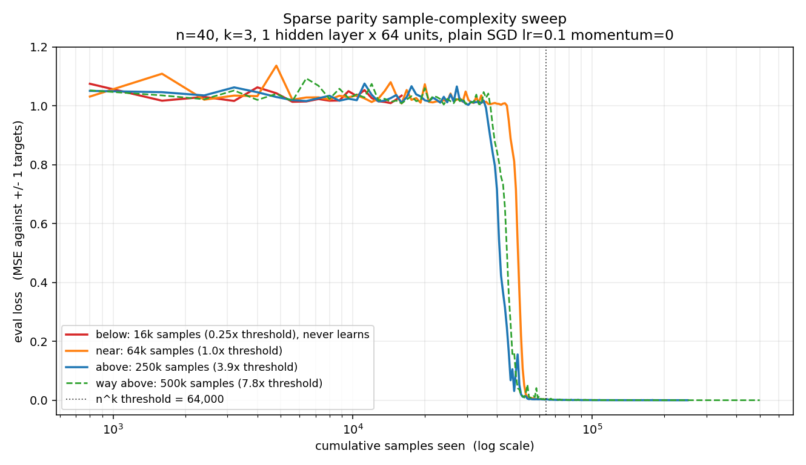
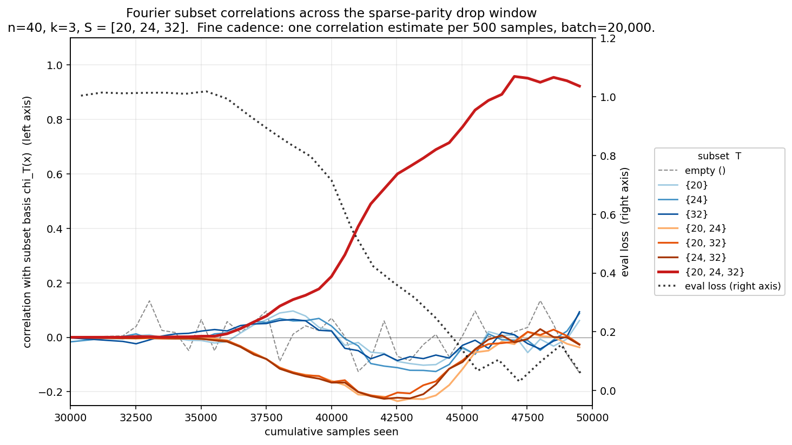

# Sparse Parity Learning Near the Computational Limit

A small MLP trained with plain SGD on a k-sparse parity function shows a
sharp transition in its learning curve. The related statistical-query (SQ)
lower bound concerns computation in a restricted query model, not an
information-theoretic sample floor or an exact threshold at `n^k` samples.
This experiment follows Barak, Edelman, Goel, Kakade, Malach, Zhang (2022)
and adds a Fourier-basis progress measure for this task that detects a signal
about 4,000-6,000 samples before the loss curve moves in one run.



The figure's `n^k threshold` marker is a reference scale, not a proven
sample cutoff.

## What is sparse parity learning, and why can it be computationally hard?

A k-sparse parity is defined by picking a fixed unknown subset `S` of size
`k` from `n` coordinates and setting `y = product of x_i for i in S`, with
inputs `x` uniform on `{-1, +1}^n`. Only `k` of the `n` coordinates matter,
but parity is orthogonal to every other parity under the uniform input
distribution. In the constant-noise SQ model, this gives a computational
lower bound of `Omega(n^k)` queries, while the statistical sample limit is
only on the order of `k log n`. Noiseless parity can also be learned in
polynomial time by Gaussian elimination. The [source paper](https://proceedings.neurips.cc/paper_files/paper/2022/file/884baf65392170763b27c914087bde01-Paper-Conference.pdf)
relates SGD's computational scaling to SQ bounds. Neither that result nor
the four sweep runs here establishes a hard sample threshold for this MLP.

## Setup

- Task: k-sparse parity, `n = 40`, `k = 3`
- Secret subset `S = [20, 24, 32]`, picked once from numpy seed 0, hard-coded
  and asserted at the start of every run
- Reference scale `n^k = 64,000` (not an exact sample threshold)
- Model: 1 hidden-layer MLP, `40 -> 64 -> 1`, ReLU, no output activation,
  about 2,700 parameters
- Loss: MSE against `+/- 1` targets
- Optimizer: plain `torch.optim.SGD`, `lr = 0.1`, `momentum = 0`, no weight
  decay, no LR schedule. The trainer rejects any non-SGD optimizer explicitly
- Sampling: the main sweep draws a fresh batch from the true distribution
  every step; the separate fixed-pool aside reuses training examples
- Batch size: 32
- Sample budgets swept: 16,000 (below), 64,000 (near), 250,000 (above),
  500,000 (way above)

## Hero result 1: the sample-complexity sweep

The sweep plots eval loss vs cumulative samples on a log x-axis across four
budgets around the `n^k` reference scale. Each budget uses one seed, so the
curves show individual trajectories rather than a distribution of outcomes.

- **Short run (16k, 0.25x `n^k`)**: stays near eval loss ~1.03 for the
  entire run. This is a negative outcome for this seed and training budget;
  it does not show that learning from fewer than `n^k` samples is impossible.
- **Near reference scale (64k, 1.0x)**: flat until samples ~44,800, then drops
  through samples ~48k-56k, converged just before the budget ends.
- **Longer run (250k, 3.9x)**: flat ends earliest at samples ~36,800,
  drops through samples ~40k-48k, converged by ~54,400, floor by ~160,000.
- **Longest run (500k, 7.8x)**: flat ends around ~38,400, drops
  through ~40k-52k, converged by ~61,600, and remains near zero loss after
  ~160k samples.

**Run-to-run scatter**: with independent seeds, the drop midpoint (first
sample at which eval loss crosses below 0.5) sits at ~41.6k, ~44.8k, and
~49.6k across the three learning runs, a ~8,000-sample spread or about 15%
of `n^k`. These are different seeds at different budgets, so the spread
cannot isolate seed variance from run configuration.

**All three learning runs converge before the `n^k` reference count**
(at ~54k-62k samples). A single `n`, `k`, and seed per budget cannot test an
asymptotic SQ scaling law or locate a universal transition point.

| Sample budget | vs `n^k` | Learned? | Flat ends | Drop midpoint | Converged (eval < 0.005) | Final eval |
|--------------:|:--------:|:--------:|----------:|--------------:|-------------------------:|-----------:|
|        16,000 |    0.25x |   **no** |     never |         never |                    never |     1.0344 |
|        64,000 |     1.0x |      yes |   ~44,800 |       ~49,600 |                  ~57,600 |     0.0028 |
|       250,000 |     3.9x |      yes |   ~36,800 |       ~41,600 |                  ~54,400 |    ~0.0001 |
|       500,000 |     7.8x |      yes |   ~38,400 |       ~44,800 |                  ~61,600 |       ~0.0 |

## Hero result 2: the Fourier correlation staircase



Once we know a phase transition exists, the next question is whether the
network is doing anything internally during the flat phase or whether
learning really is instantaneous at the drop. To probe this, at fine sample
cadence through the drop window (samples 30k-50k, one correlation estimate
per 500 samples, batch of 20,000 fresh samples per estimate), we compute the
empirical Walsh-Hadamard correlation of the network output `f` with every
subset basis function `chi_T(x) = product of x_i for i in T`, for each of
the `2^k = 8` subsets of `S`: the empty set, three singletons, three pairs,
and the full triple.

Under uniform `+/- 1` inputs these are exactly the Fourier coefficients of
`f` restricted to subsets of `S`. If the model has learned the parity we
expect `corr_{full triple} -> 1` and every other subset `-> 0`. The
interesting question is the temporal ordering during the drop.

What actually happens on the 250k run:

- The **full triple {20, 24, 32}** correlation (bold red) rises from ~0 to
  ~1.0 across samples 35k-47k. Dominant signal.
- The **three pair correlations** (orange shades) all dip **signed negative**
  to about -0.2 around samples 40k-43k, then decay back to 0 as the triple
  locks in. The sign is real, not an artifact: the model is briefly
  representing a specifically negatively correlated pairwise feature during
  the transition, not just picking up magnitude. All three sub-pairs of `S`
  behave nearly identically.
- The **three singleton correlations** (blue shades) show a smaller signed
  dip in the same direction, staying under 0.1 in absolute magnitude, and
  never dominate.
- The **empty-set correlation** (gray dashed) is noisy jitter around 0,
  consistent with the balanced parity target having zero mean.
- **Eval loss** (black dotted, right axis) is still ~1.0 through samples
  ~40k, only visibly moving from samples ~42k onward.

**The lead time of the Fourier signal over the loss curve is modest but
real: about 4,000-6,000 samples.** The pair correlations first depart from
noise (|corr| exceeds ~0.05) around samples 37k, at which point eval loss
is still ~0.95, indistinguishable from random guessing. Eval loss does not
visibly move until samples ~42k. That is the honest version. The Fourier
tracker sees the phase transition coming a few thousand samples earlier
than the loss does, in a run that spans 250,000 samples. It is a real
progress signal, not a dramatic early warning.

## Why this diagnostic matters

The progress-measures framing (Nanda et al., 2023) argues that many events
which look like sudden phase transitions in loss are actually smooth
internal transitions when you measure the right internal quantity. The
Fourier tracker built here is a version of that idea specialized to sparse
parity: instead of the loss, use the empirical correlations with the
natural Fourier basis of the problem. It was constructed from scratch for
this task rather than adapted from prior work. For parity, the
Walsh-Hadamard basis is the natural feature set and there is no ambiguity
about which coefficients to inspect.

The result is a legitimate but modest progress signal. It does not turn a
discontinuous-looking loss curve into a smoothly rising internal curve. It
shows a few thousand samples of lead time between the first pair
correlations crossing noise and the loss actually moving, no more. That is
still useful: it is direct evidence that the "flat" phase is not fully
flat internally, and that the eventual learning event is preceded by
measurable structure in the network output.

## An aside: the fixed-pool multi-pass result

For completeness, `configs/aside_fixed_pool.yaml` trains the same MLP but
restricts the training data to a fixed pool of 25,600 sampled rows
(~0.4x `n^k`) and cycles through them for 78 epochs, or 2,000,000 total
sample views. Eval is still fresh online. The model reaches essentially
zero eval loss.

This is compatible with the SQ computational lower bound. The fixed-pool run
has 25,600 sampled training rows and 2,000,000 sample views, while the
short online run stops after 16,000 fresh examples. Both the data budget and
the amount of optimization differ, so these runs alone do not identify
repeated access as the cause of learning. The fixed-pool result also
illustrates why `n^k` should not be read as an information-theoretic minimum
number of distinct examples.

Data: `results/aside_fixed_pool/log.csv`.

## What I'd explore next

- **Directly probe hidden-unit activations to test the pair-feature
  hypothesis.** The signed-negative dip in the pair correlations during the
  drop is consistent with the network briefly representing the parity via
  ReLU units that gate on pairwise interactions `x_i * x_j` before locking
  in on the full three-way product. That is a plausible mechanistic story
  but not established here: only output-level Fourier signatures were
  measured, not internal features. The concrete follow-up is to inspect
  the first-layer weight vectors and per-unit activations during samples
  37k-45k and check whether individual units concentrate weight on pairs
  of indices from `S`. If they do, the hypothesis is supported. If they
  do not, the pair correlations have some other origin, e.g. a distributed
  pair-like signal spread across many units.
- **Sweep k.** Move from `k = 3` to `k = 4` (`40^4 = 2,560,000` as a
  reference count) and test how the drop location scales and whether the
  low-degree Fourier staircase becomes more pronounced. The classic
  prediction is that larger `k` gives a longer, more visible search phase
  and a wider separation between low-degree and full-degree Fourier signals.
- **Repeat with Adam** instead of plain SGD. Compare drop locations across
  multiple seeds to test whether adaptive updates change the observed
  training dynamics.
- **Scale n.** `n = 50, k = 3` gives `n^k = 125,000`; `n = 100,
  k = 3` gives `n^k = 10^6`. Multiple sizes and seeds would make a scaling
  claim testable.
- **Multiple seeds per budget in the sweep** to get error bars on the drop
  location rather than the current single-seed-per-budget summary.

## Running it

```bash
# Sanity check: confirm the flat-then-drop shape appears for this seed
python3 train.py --config configs/sanity.yaml

# Sweep (independent seeds per run)
python3 train.py --config configs/sweep_below.yaml
python3 train.py --config configs/sweep_near.yaml
python3 train.py --config configs/sweep_above.yaml
python3 train.py --config configs/sweep_way_above.yaml

# Aside: fixed pool of 25.6k samples cycled 78 epochs
python3 train.py --config configs/aside_fixed_pool.yaml

# Fourier tracker: re-runs sweep_above with identical seeds so the model
# trajectory reproduces bit-for-bit, then at fine cadence through the drop
# window computes all 8 subset correlations from a separate fourier RNG
python3 fourier.py --config configs/sweep_above.yaml

# Regenerate both hero plots from the CSVs
python3 plot.py
```

## References

- Barak, Edelman, Goel, Kakade, Malach, Zhang. *Hidden Progress in Deep
  Learning: SGD Learns Parities Near the Computational Limit*, 2022.
- Nanda, Chan, Lieberum, Smith, Steinhardt. *Progress Measures for Grokking
  via Mechanistic Interpretability*, 2023.
